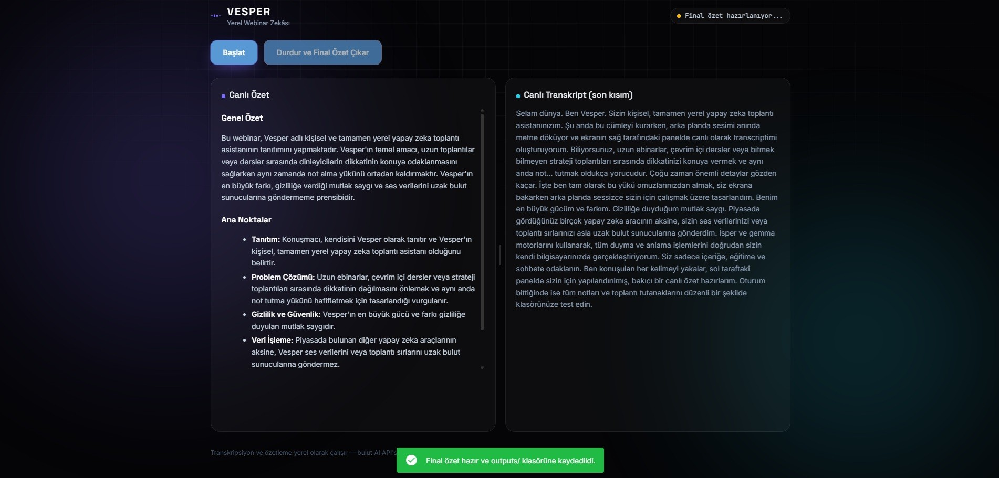

<p align="center">
  
</p>

<h1 align="center">Vesper</h1>

<p align="center">
  <i>She was in the room. She took notes.</i>
</p>

<p align="center">
  <b>Listens to your webinars, hands you the minutes.</b><br>
  Local Whisper + Ollama. No cloud APIs.
</p>

<p align="center">
  
  
  
  
  
</p>

---

**v0.5 geliştirme / sürüm kabulü HOLD.** Son yayınlanan sürüm v0.4.0'dır.
v0.5'te elle link/not materyalleri, şema v2 ve güvenli göç, Geçmiş materyalleri
ve otomatik Markdown uygulanmıştır; bağımsız son onay beklenir.
**Üretim veritabanı göçü HOLD**; aşağıdaki genel başlatma örnekleri mevcut
üretim DB'sine karşı bu geliştirme sürümünü çalıştırma izni değildir.

### v0.5 materyaller, ortam ve kabul sınırı

- Meeting Materials yalnızca etkin toplantıya **elle Link veya Note** ekler.
  HTTP/HTTPS link doğrulanır, not biçimi korunur. E-posta alıntıları elle nottur;
  otomatik Teams/Zoom/Meet/Outlook/Gmail sohbeti, dosya/OCR veya pano izleme yoktur.
- Geçmiş seçili oturumun materyallerini gösterir ve onayla siler; Geçmiş'ten
  yeni materyal eklenmez. Oturum/segment sahipliği SQLite tarafından da korunur.
- Durdur final özetini kaydedip otomatik `webinar_YYYYMMDD_HHMMSS.md` üretir;
  manuel indirme düğmesi yoktur. Özet, transkript ve materyal türü/içeriği/zamanı
  SQLite'tan alınır. Materyal metni etkin HTML/Markdown olarak yorumlanmaz.
  Dosya **anlık görüntüdür**: sonraki Geçmiş silme/yeniden adlandırma işlemleri
  eski dosyayı değiştirmez. Kabul başlatıcısı çıktıyı deneyin `runs/<id>/outputs`
  klasörüne yönlendirir; repository `outputs/` klasörüne değil. Mutlak yol konsola yazılır.
- Şema v2 kullanılır. `Database(..., allow_migration=False)` varsayılandır;
  v1 otomatik yükseltilmez. Açık `allow_migration=True` ayrı yetkili yükseltme
  adımının API'sidir, bu doküman üretim göçü onayı değildir. Yetkili göç,
  kilit altında doğrulama ve tarihsel veri varsa doğrulanmış yedek gerektirir.
- Destek hedefi Windows x64 / CPython 3.13; **kesin doğrulanmış ortam Python
  3.13.14 / SQLite 3.53.4 / NiceGUI 3.16.0**'dır. Önceki 3.10–3.12/3.11
  bilgileri tarihsel referanstır; başka runtime uyumluluğu varsayılmaz.
  Sistem CUDA 12.8 + cuDNN 9, Whisper GPU ve Ollama CPU politikası korunur.
- [release-tooling.json](release-tooling.json), dış başlatıcı SHA-256'sını,
  konumunu, 49 Conda + 45 pip paketli donmuş ortamın artifact/kurulum kanıtlarını
  ve ayrı onaylı provisioning adımlarını içerir. `requirements.txt` yalnızca
  genel alt sınırlardır; tek başına bu runtime'ı yeniden üretmez. Eksik veya
  hash'i değişmiş dış başlatıcı testleri başarısız olur. Aynı baytlı kopya için
  `VESPER_ACCEPTANCE_LAUNCHER` test yolu kullanılabilir; CLI konum koruması sürer.
- Yeni başlatıcıda `shutdown-snapshot.json` yalnızca ara kanıt,
  `terminal.json` tek yetkili sonuçtur. Ctrl+C ancak finalizasyon, işçiler,
  temizlik, ASGI ve server kapanışı kanıtlanırsa PASS olabilir. Tarihsel iki
  kabul deneyinin çelişkili kayıtları değiştirilmez; yeni gerçek kapanış henüz denenmedi.
- **Ertelenmiş manuel kriterler:** A/B oturum yalıtımı; materyal silme onayı/iptali;
  yeniden başlatmada kalıcılık; 240 saniyelik canlı özet; doğrudan Ollama CPU
  yürütme kanıtı. Bunlar geçti sayılmaz; sürüm kabulü HOLD kalır.

Vesper, bilgisayarında oynatılan webinarı, canlı dersi veya toplantıyı doğrudan **hoparlör çıkışından** (varsayılan çıkış ya da seçtiğin bir çıkış cihazı) dinler; konuşmayı metne dönüştürür (konuşma dilini başlatmadan önce **Türkçe**, **English** veya **Otomatik** olarak seçebilirsin), oturum sürerken düzenli olarak güncellenen bir **canlı özet** tutar ve oturum bittiğinde **tutanak formatında final özet + tam transkript** bırakır. Özetler Türkçe üretilir (konuşma dili seçiminden bağımsız).

Transkripsiyon ve özetleme kendi makinen üzerinde gerçekleşir. Ses bir bulut AI servisine gönderilmez ve API anahtarı gerekmez. Modeller ilk kullanımda indirildikten sonra temel inference akışı yerel olarak çalışabilir.

<p align="center">
  
</p>

<p align="center">
  <sub>Live transcription and AI-generated summaries running locally on Windows.</sub>
</p>

## Nasıl çalışır?

```text
┌──────────────────────┐
│ Windows System Audio │
│   WASAPI Loopback    │
└──────────┬───────────┘
           │
           ▼
┌──────────────────────┐
│      WebRTC VAD      │
│ konuşma / sessizlik  │
└──────────┬───────────┘
           │ 16 kHz mono
           ▼
┌──────────────────────┐
│    faster-whisper    │
│     CTranslate2      │
│     NVIDIA GPU       │
└──────────┬───────────┘
           │
           ▼
       Transcript ───────────► SQLite (data/vesper.db)
           │                    her parça üretildiği anda
           ▼                    kalıcı olarak yazılır
┌──────────────────────┐
│    Ollama + LLM      │
│  (Gemma / Qwen) CPU  │
└──────────┬───────────┘
           │
           ▼
 Live Summary + Final Minutes ─► SQLite (summaries)
           │
           ▼
  outputs/*.md (dışa aktarım)  +  Geçmiş sekmesi (SQLite'tan okunur)
```

- **Ses yakalama:** Windows'un WASAPI loopback özelliğini kullanır. Mikrofonu dinlemek yerine bir çıkış cihazından oynatılan sesi yakalar. Varsayılan seçenek **"Sistem varsayılanı (otomatik)"** Windows'un varsayılan çıkışını kullanır; oturumu başlatmadan önce listeden belirli bir WASAPI loopback çıkış kaynağını da seçebilirsin. Seçilen şey bir *çıkış cihazıdır* — belirli bir uygulamanın sesini ayırmak (uygulama bazlı loopback) henüz desteklenmez.
- **Konuşma tespiti:** `webrtcvad`, sesi konuşma ve sessizlik sınırlarına göre parçalar; gereksiz sessiz bölümlerin Whisper'a gönderilmesini azaltır.
- **ASR:** `faster-whisper` + CTranslate2 üzerinde Whisper large-v3-turbo, NVIDIA GPU ile çalışır.
- **Konuşma dili (v0.4.0):** Oturumu başlatmadan önce Whisper'ın kaynak (transkripsiyon) dilini seçersin: **Türkçe** (varsayılan), **English** veya **Otomatik**. Bu seçici *yalnızca konuşmanın hangi dilde yazıya geçirileceğini* belirler; **özetler v0.4'te her zaman Türkçe kalır** — bu bilinçli bir tasarım kararıdır. Yani English seçersen sonuç şudur: İngilizce konuşma → İngilizce transkript → Türkçe özet. Bu bir hata değildir; Vesper'da çeviri veya altyazı çevirisi özelliği yoktur. **Otomatik**, Whisper'ın yerel dil algılamasını kullanır ve Türkçe/İngilizce karışık içerik için kullanışlıdır; algılama kısa, gürültülü veya dilin sık değiştiği konuşmalarda kusurlu olabilir ve Vesper algılanan dili parça başına kaydetmez. Seçim oturum başında sabitlenir. Dil işleme tamamen yerel çalışır; bulut dil API'si kullanılmaz.
- **Özetleme:** Ollama üzerinden yerel bir LLM kullanılır. İki profil vardır: **Kaliteli** (`gemma4:e2b`, varsayılan) ve **Hızlı** (`qwen2.5:3b`). Referans makinede Qwen'in özetleri daha hızlı ürettiği gözlendi; iki modelin çıktı ayrıntısı/kalitesi farklı olabilir. Vesper'ın tasarımında özetleme her iki profilde de CPU'da çalışır; böylece GPU belleği Whisper'a kalır. Özet çıktısı v0.4'te her zaman Türkçedir; seçtiğin konuşma dili özet dilini değiştirmez.
- **Canlı özet:** Belirlenen aralıklarla o ana kadarki transkript yeniden özetlenir.
- **Kalıcılık (v0.2.0):** Her transkript parçası ve her özet, üretildiği anda `data/vesper.db` (SQLite) içine yazılır — Durdur'a basılmasını beklemez. Uygulama beklenmedik şekilde kapanırsa (çökme, güç kesintisi, `kill`), o ana kadar transkript edilmiş olan her şey diskte kalır ve bir sonraki açılışta Geçmiş'te "yarıda kesildi" olarak görünür. `outputs/*.md` dosyaları hâlâ üretilir ama artık bir dışa aktarımdır — kaynak veri SQLite'tadır. Her özet, hangi modelle üretildiği bilgisiyle birlikte kaydedilir. Oturumun konuşma (kaynak) dili seçimi de oturum ve transkript parçası kayıtlarıyla birlikte saklanır (Türkçe → `tr`, English → `en`, Otomatik → boş/NULL; Otomatik'te boş değer "otomatik mod seçildi" demektir, gerçekte algılanan dilin kaydedildiği anlamına gelmez).
- **Arayüz:** NiceGUI tabanlı yerel web arayüzü tarayıcıdan veya aynı yerel ağdaki başka bir cihazdan görüntülenebilir. "Oturum" (canlı görünüm) ve "Geçmiş" (kayıtlı oturumlar) olmak üzere iki sekme vardır. "Oturum" sekmesinde ses kaynağı, konuşma dili ve LLM profili seçicileri bulunur; üçü de oturum sürerken kilitlidir.

## Gereksinimler

| Bileşen | Minimum / Beklenen | Test edilen ortam |
|---|---|---|
| İşletim sistemi | Windows 10 / 11 64-bit | Windows 11 |
| GPU | CUDA destekli NVIDIA GPU | RTX 4050 Laptop GPU, 6 GB VRAM |
| Hibrit grafik | Desteklenebilir | AMD iGPU + NVIDIA |
| RAM | 12 GB+ | 16 GB |
| Python / SQLite | Windows x64 CPython 3.13 hedefi | Python 3.13.14 / SQLite 3.53.4 (yalıtılmış referans) |
| CUDA | CUDA 12 ailesi | CUDA Toolkit 12.8 |
| cuDNN | cuDNN 9 / CUDA 12 | cuDNN 9 |
| Disk | Modeller + CUDA için birkaç GB boş alan | — |

> Vesper'ın mevcut/test edilen GPU bağımlılık seti **CUDA 12 + cuDNN 9** kullanır. CTranslate2/faster-whisper'ın gelecekteki sürümlerinde desteklenen CUDA kombinasyonları değişebileceğinden bağımlılık güncellerken upstream dokümantasyonunu da kontrol et.

GPU'suz kullanım mümkündür:

```python
WHISPER_DEVICE = "cpu"
```

Ancak large-v3-turbo CPU üzerinde gerçek zamanlı kullanım için ağır olabilir. CPU-only sistemlerde daha küçük bir Whisper modeli tercih etmek daha uygundur.

---

## Kurulum

Kurulumu şu sırayla yapmak önerilir:

```text
NVIDIA Driver
     ↓
CUDA Toolkit + cuDNN
     ↓
Ollama + modeller
     ↓
Python environment
     ↓
Vesper
```

### 1. NVIDIA sürücüsü

[NVIDIA Drivers](https://www.nvidia.com/drivers) üzerinden GPU'n için güncel Windows sürücüsünü indir.

Mevcut CUDA kurulumunda sorun yaşadıysan kurulum sırasında:

```text
Custom (Advanced)
→ Perform a clean installation
```

seçeneği yararlı olabilir.

Kurulumdan sonra yeniden başlat ve PowerShell'de:

```powershell
nvidia-smi
```

çalıştır.

GPU'nun listelendiğini ve sürücünün doğru yüklendiğini doğrula.

> `nvidia-smi` içindeki **CUDA Version**, bilgisayarda kurulu CUDA Toolkit sürümünü göstermez. NVIDIA sürücüsünün desteklediği CUDA seviyesini ifade eder.

### 2. CUDA Toolkit 12.8

Vesper için referans/test edilen kurulum **CUDA Toolkit 12.8 + cuDNN 9 (CUDA 12)** kombinasyonudur.

CUDA Toolkit:

https://developer.nvidia.com/cuda-toolkit-archive

Şunları seç:

```text
CUDA Toolkit 12.8.x
Windows
x86_64
exe (local)
```

Kurulumda:

```text
Custom (Advanced)
```

seçeneğini kullan.

Eğer güncel NVIDIA sürücüsünü zaten ayrı olarak kurduysan Toolkit paketindeki display-driver bileşenini yeniden kurman gerekmez.

CUDA tarafında temel olarak Runtime/Libraries ve Development bileşenleri yeterlidir. Nsight ve Visual Studio entegrasyonları Vesper'ın çalışması için gerekli değildir.

Kurulumdan sonra **yeni bir PowerShell** aç:

```powershell
echo $env:CUDA_PATH
nvcc --version
```

Örneğin:

```text
C:\Program Files\NVIDIA GPU Computing Toolkit\CUDA\v12.8
```

görmelisin.

### 3. cuDNN 9 — CUDA 12

NVIDIA'nın resmi indirme sayfasından cuDNN 9'un **CUDA 12** varyantını indir:

https://developer.nvidia.com/cudnn-downloads

Windows ZIP/Tarball paketini kullanıyorsan dosya adının CUDA 12 paketini gösterdiğinden emin ol.

Arşivdeki dosyaları CUDA Toolkit dizinine yerleştir:

```text
cuDNN bin\*.dll
    ↓
C:\Program Files\NVIDIA GPU Computing Toolkit\CUDA\v12.8\bin

cuDNN include\*
    ↓
C:\Program Files\NVIDIA GPU Computing Toolkit\CUDA\v12.8\include

cuDNN lib\x64\*.lib
    ↓
C:\Program Files\NVIDIA GPU Computing Toolkit\CUDA\v12.8\lib\x64
```

Ardından yeni bir PowerShell aç:

```powershell
where.exe cublas64_12.dll
where.exe cudnn64_9.dll
```

Beklenen kaynak CUDA Toolkit'in `bin` dizinidir:

```text
...\CUDA\v12.8\bin\cublas64_12.dll
...\CUDA\v12.8\bin\cudnn64_9.dll
```

Birden fazla sonuç görmek tek başına bir hata değildir. Ancak farklı uygulamalardan gelen birden fazla CUDA/cuDNN sürümünün PATH üzerinde bulunması, Windows DLL yükleme sırasını belirsizleştirerek teşhisi zorlaştırabilir.

Bu nedenle Vesper için CUDA DLL'lerinin tercihen **tek ve tutarlı bir NVIDIA CUDA kurulumundan** gelmesi önerilir.

> Vesper'ın referans kurulumu CUDA/cuDNN çalışma zamanı için pip'teki `nvidia-cublas-cu12` ve `nvidia-cudnn-cu12` paketlerini kullanmaz. Amaç olası DLL sürüm ve arama yolu çakışmalarını azaltmaktır.

### 4. Ollama + modeller

[Ollama](https://ollama.com/) Windows sürümünü kur.

Vesper'ın iki özetleme profili vardır:

| Profil | Model | Gerekli mi? |
|---|---|---|
| **Kaliteli** (varsayılan) | `gemma4:e2b` | Gerekli — varsayılan profildir |
| **Hızlı** | `qwen2.5:3b` | İsteğe bağlı — yalnızca Hızlı profili kullanacaksan |

Varsayılan (Kaliteli) profil için gerekli model:

```powershell
ollama pull gemma4:e2b
```

Yalnızca **Hızlı** profili de kullanmak istiyorsan ayrıca:

```powershell
ollama pull qwen2.5:3b
```

Hızlı profili kullanmayacaksan `qwen2.5:3b` indirmen gerekmez.

> Vesper hiçbir Ollama modelini kendiliğinden indirmez. Modelleri yukarıdaki gibi sen indirirsin; bir profilin modeli yüklü değilse Vesper o profile geçişi reddeder ve mevcut profil aktif kalır.

Modelleri doğrula:

```powershell
ollama list
```

API'nin çalıştığını kontrol etmek istersen:

```powershell
curl http://localhost:11434/api/tags
```

Varsayılan Vesper yapılandırması, her iki profilde de özetleme modelini CPU'da çalıştırır:

```python
OLLAMA_FORCE_CPU = True
```

Ollama CUDA backend'inde sistemine özgü bir sorun yaşıyorsan ayrıca kullanıcı ortam değişkeni olarak:

```text
OLLAMA_LLM_LIBRARY=cpu
```

tanımlayabilirsin.

PowerShell ile:

```powershell
[Environment]::SetEnvironmentVariable("OLLAMA_LLM_LIBRARY", "cpu", "User")
```

Sonrasında Ollama'yı tamamen kapatıp yeniden başlat.

### 5. Vesper'ı kur

Repoyu klonla:

```powershell
git clone https://github.com/hsynylmz-umhg/Vesper.git
cd Vesper
```

Aşağıdaki venv/pip örnekleri genel kurulum bilgisidir; v0.5 referans ortamının yeniden üretimi değildir. v0.5 için önce `release-tooling.json` kanıtları ve ayrı kurulum onayı gerekir. Anaconda base değiştirilmez.

Ayrı bir Python ortamı oluşturmak önerilir:

```powershell
python -m venv .venv
.\.venv\Scripts\Activate.ps1
```

PowerShell sanal ortam script'ini engelliyorsa:

```powershell
Set-ExecutionPolicy -Scope CurrentUser RemoteSigned
```

Ardından:

```powershell
python -m pip install --upgrade pip
pip install -r requirements.txt
```

> Anaconda/Miniconda kullanıyorsan `base` ortamına kurmak yerine ayrı bir environment oluşturmak DLL/NumPy çakışmalarını önlemeye yardımcı olabilir.

v0.5 için doğrulanmış yalıtılmış ortam Python **3.13.14 / SQLite 3.53.4**
kullanır. Conda kurulumu, `release-tooling.json` içinde tanımlanan onaylı
yerel artifact paketi ve doğrulayıcılarla ayrı izin altında yapılır.
Yalnızca Python sürümü seçmek veya `requirements.txt` kurmak aynı SQLite
DLL'ini ve doğrulanmış ortamı sağlamaz. Eski Python 3.11 kurulum örnekleri
v0.4 için tarihsel bilgidir; v0.5 kurulum önerisi değildir.

---

## İlk çalıştırmadan önce

Vesper iki bağımsız tanı aracı içerir. Tam uygulamadan önce ikisini çalıştırmak sorunları çok daha kolay ayırır.

### 1. Sistem sesini test et

Bilgisayarda bir video veya müzik oynatırken:

```powershell
python test_audio.py
```

Şuna benzer hareketli çubuklar görüyorsan:

```text
0.0s  #######
0.5s  ##############
1.0s  ####################
```

WASAPI loopback ses yakalama katmanı çalışıyor demektir.

### 2. GPU zincirini test et

```powershell
python gpu_check.py
```

Tanı aracı sırasıyla:

```text
CUDA DLLs
   ↓
CTranslate2
   ↓
CUDA device detection
   ↓
supported compute types
   ↓
small Whisper inference
   ↓
Vesper target model
```

katmanlarını kontrol eder.

İlk CUDA/cuDNN yüklemesi sonraki çalıştırmalardan daha uzun sürebilir. Disk, antivirüs, shader/kernel cache ve sürücü durumuna bağlı olarak süre sistemden sisteme değişebilir.

Başka bir terminalde GPU kullanımını izlemek için:

```powershell
nvidia-smi -l 1
```

kullanabilirsin.

`gpu_check.py` başarıyla tamamlanıyorsa tam uygulamaya geç.

---

## Çalıştırma

Web arayüzünü başlat:

```powershell
python ui.py
```

NiceGUI hazır olduğunda:

http://localhost:8080

adresini aç.

Aynı yerel ağdaki başka bir cihazdan da bilgisayarının LAN IP adresini kullanabilirsin:

```text
http://192.168.1.23:8080
```

### Kullanım

**Başlatmadan önce (isteğe bağlı):** Başlat düğmesinin yanındaki üç seçiciyi kullanabilirsin (soldan sağa sıra: **Ses cihazı → Konuşma dili → LLM profili → Başlat → Durdur**):

- **Ses cihazı:** Varsayılan **"Sistem varsayılanı (otomatik)"** önceki davranışı korur: Windows'un varsayılan çıkış cihazının sesi yakalanır. İstersen listeden belirli bir WASAPI loopback çıkış kaynağını seçebilirsin. Belirli bir uygulamanın sesini ayırmak (uygulama bazlı loopback) henüz desteklenmez. Cihaz listesi uygulama açıkken canlı olarak güncellenmeyebilir; kullanacağın cihazı `python ui.py`'yi başlatmadan önce bağla.
- **Konuşma dili:** **Türkçe** varsayılandır (`config.py`'deki `WHISPER_LANGUAGE`). Konuşma Türkçeyse Türkçe, İngilizceyse English, Türkçe/İngilizce karışıksa Otomatik'i seç. Bu seçici yalnızca transkripsiyon dilini belirler; özet her zaman Türkçedir (English seçersen: İngilizce transkript, Türkçe özet — beklenen davranıştır). Konuşmanın gerçek diliyle uyuşmayan bir dil seçersen transkript bozuk çıkabilir.
- **LLM profili:** **Kaliteli (gemma4:e2b)** varsayılandır. **Hızlı (qwen2.5:3b)** için önce `ollama pull qwen2.5:3b` gerekir (bkz. Kurulum, adım 4).

Oturum sürerken üç seçici de kilitlidir (konuşma dili oturum başında sabitlenir; oturumlar arasında değiştirilebilir); **Durdur ve Final Özet Çıkar**'dan sonra tekrar açılır. Oturum sırasında kaynak değiştirilemez; Vesper başka bir cihaza kendiliğinden geçmez ve kaynak koparsa yeniden bağlanmaz.

1. **Başlat** düğmesine bas. Yeni oturum otomatik olarak `Webinar — YYYY-MM-DD HH:MM` gibi bir başlıkla kaydedilmeye başlar (SQLite'a).
2. Webinarı, canlı dersi veya toplantıyı oynat.
3. Vesper konuşma parçalarını algılayıp Whisper'a gönderir; her parça üretildiği anda kalıcı olarak yazılır.
4. Transkript arayüzde görünür.
5. Canlı özet belirlenen aralıklarla güncellenir ve kaydedilir.
6. Oturum sonunda **Durdur ve Final Özet Çıkar** düğmesine bas. Final özet kaydedilir, oturum "tamamlandı" olarak işaretlenir.

Final çıktı hem SQLite'a (`data/vesper.db`, kalıcı kaynak) hem de geriye dönük uyumluluk için:

```text
outputs/webinar_YYYYMMDD_HHMMSS.md
```

altına Markdown olarak kaydedilir. Oturumu daha sonra **Geçmiş** sekmesinden yeniden adlandırabilir, açabilir veya silebilirsin.

Arayüzsüz kullanım için:

```powershell
python main.py
```

Ctrl+C ile durdurulduğunda final özet oluşturulur ve aynı şekilde kalıcı olarak kaydedilir. Bu modda ses kaynağı, konuşma dili ve LLM profili seçilemez; varsayılanlar (Sistem varsayılanı, `config.py`'deki `WHISPER_LANGUAGE` — varsayılan yapılandırmada Türkçe — ve Kaliteli profil) kullanılır.

### Örnek çıktı

```markdown
# Webinar — 2026-09-03 14:05

## Genel Özet

...

## Ana Noktalar

- ...
- ...

## Aksiyon Maddeleri / Kararlar

- ...

---

## Tam Transkript

...
```

---

## Yapılandırma

Vesper'ın çalışma ayarları `config.py` içerisindedir.

| Ayar | Varsayılan | Açıklama |
|---|---|---|
| `WHISPER_LANGUAGE` | `"tr"` | Açılışta seçili gelen (başlangıç/varsayılan) konuşma dili. `"tr"` → Türkçe, `"en"` → English, `None` → Otomatik. Geçersiz/desteklenmeyen değerler uyarıyla Türkçe'ye döner |
| `SOURCE_LANGUAGES` | `tr` → Türkçe, `en` → English, `auto` → Otomatik | Arayüzdeki konuşma dili seçenekleri. Resmi seçenekler yalnızca `tr`, `en` ve `auto`'dur; yalnızca görünen etiketler ve sıra değiştirilebilir. Geçersiz bir tablo uyarıyla yerleşik varsayılana döner |
| `WHISPER_COMPUTE_TYPE` | `"float16"` | GPU inference hassasiyeti / bellek dengesi |
| `WHISPER_ALLOW_CPU_FALLBACK` | `True` | GPU başlatılamazsa CPU'ya geçilmesine izin verir |
| `WHISPER_GPU_INDEX` | `0` | Kullanılacak CUDA cihazı |
| `WHISPER_MIN_CHUNK_SEC` | `0.3` | Çok kısa ses parçalarını filtreler |
| `LLM_PROFILES` | `fast` → `qwen2.5:3b` (Hızlı), `quality` → `gemma4:e2b` (Kaliteli) | Arayüzdeki LLM profilleri. Her profil yalnızca bir ad (`label`) ve bir model (`model`) taşır; model adı açık etiketli olmalı (ör. `qwen2.5:3b`) ve `ollama list` çıktısıyla birebir aynı yazılmalıdır |
| `DEFAULT_LLM_PROFILE` | `"quality"` | Uygulama açıldığında seçili gelen profil (Kaliteli) |
| `OLLAMA_MODEL` | `"gemma4:e2b"` | Geriye dönük uyumluluk için eski (legacy) yedek ayar: profil tanımı bulunamadığında veya geçersiz olduğunda kullanılır. Varsayılan yapılandırmada modeli değiştirmek için `LLM_PROFILES` düzenlenir |
| `OLLAMA_NUM_CTX` | `32768` | Ollama bağlam penceresi; tüm profiller için ortaktır |
| `OLLAMA_FORCE_CPU` | `True` | Özetleme LLM'ini (her iki profilde de) CPU üzerinde tutar; tüm profiller için ortaktır |
| `LIVE_SUMMARY_INTERVAL_SEC` | `240` | Canlı özet yenileme aralığı |
| `SILENCE_TIMEOUT_MS` | `700` | Konuşma parçasını kapatmadan önce beklenecek sessizlik |
| `MAX_CHUNK_SECONDS` | `25` | Tek Whisper parçasının maksimum uzunluğu |

> v0.2.0'dan yükseltiyorsan ve `OLLAMA_MODEL`'i değiştirmiştiysen: seçtiğin modeli artık `LLM_PROFILES` içindeki ilgili profile yaz.

### Konuşma dili

Arayüzdeki **Konuşma dili** seçicisi uygulama açılırken `WHISPER_LANGUAGE` değeriyle başlar; oturumdan önce arayüzden değiştirilebilir. Varsayılan (ağırlıklı Türkçe içerik):

```python
WHISPER_LANGUAGE = "tr"
```

Açılışta **Otomatik** seçili gelsin istersen (Türkçe ve İngilizcenin karıştığı oturumlar):

```python
WHISPER_LANGUAGE = None
```

`"en"` değeri açılışta English'i seçili getirir. Resmi seçenekler yalnızca `"tr"`, `"en"` ve `None` (Otomatik)'tir; başka bir değer (ör. `"de"`) yazarsan logda bir uyarı görürsün ve Vesper güvenli şekilde Türkçe'ye döner. Otomatik, dil algılama yaptığı için bir miktar ek işlem gerektirebilir ve kısa, gürültülü veya karma konuşmalarda kusurlu olabilir.

### GPU compute type

Varsayılan:

```python
WHISPER_COMPUTE_TYPE = "float16"
```

En iyi seçim GPU modeline göre benchmark edilmelidir.

---

## Gizlilik

Vesper'ın temel tasarım hedeflerinden biri transkripsiyon ve özetleme verisini yerel makinede tutmaktır.

```text
System Audio
     ↓
Local Whisper
     ↓
Local Transcript
     ↓
Local Ollama (Gemma / Qwen)
     ↓
Local Markdown Output
```

Vesper'ın normal inference akışı sesi veya transkripti OpenAI, Google, Anthropic gibi harici bir AI API'sine göndermez. Bir LLM profili seçilirken yapılan model kontrolü yalnızca yerel Ollama servisine sorar; model indirmez ve bulut tabanlı bir model API'si çağırmaz.

**Kalıcı depolama (v0.2.0):** Transkript parçaları ve özetler artık oturum sırasında `data/vesper.db` (yerel bir SQLite dosyası) içine yazılır; bu, `outputs/` altındaki Markdown dosyalarıyla aynı diskte, tamamen yerel bir depodur — hiçbir ağ isteği içermez. Mevcut üretim verisi bu geliştirme akışında silinmez, incelenmez veya göç ettirilmez; veri saklama ve yükseltme işlemleri ayrı açık onay gerektirir. Üretim göçü HOLD durumundadır.

**Dil seçimi (v0.4.0):** Otomatik dil algılama dahil tüm dil işleme yerel Whisper içinde gerçekleşir; bulut dil/çeviri API'si kullanılmaz ve dil tespiti için ağ isteği yapılmaz. Dil bilgisi olarak veritabanına yalnızca seçilen yapılandırma yazılır: Türkçe → `tr`, English → `en`, Otomatik → boş (NULL). Otomatik için boş değer "otomatik algılama modu seçildi" anlamına gelir; Vesper'ın gerçekte algılanan dili kaydettiği anlamına gelmez.

İlk kurulum sırasında:

- Python bağımlılıklarının,
- Whisper modelinin,
- Ollama'nın,
- Ollama modellerinin (varsayılan Kaliteli profil için Gemma, isteğe bağlı Hızlı profil için Qwen)

indirilmesi için internet bağlantısı gerekir.

Modeller ve bağımlılıklar hazır olduğunda temel transkripsiyon ve özetleme akışı yerel olarak çalışabilir.

> **Kayıt ve gizlilik uyarısı:** Toplantıların, derslerin veya görüşmelerin kaydedilmesi/transkribe edilmesi bulunduğun ülkeye, organizasyona ve görüşmenin niteliğine göre izin veya bilgilendirme gerektirebilir. Vesper'ı yalnızca kaydetmeye veya transkribe etmeye yetkili olduğun içeriklerde kullan.

---

## Tasarım kararları

### Neden Whisper GPU'da, özetleme LLM'i CPU'da?

Transkripsiyon gecikmeye duyarlıdır. Özetleme ise yalnızca belirli aralıklarla gerçekleştirilir.

Bu nedenle varsayılan mimari:

```text
NVIDIA GPU → Whisper
CPU        → Ollama LLM (Gemma / Qwen)
```

şeklindedir.

Test sisteminde large-v3-turbo çalışma koşullarına göre yaklaşık 2–3 GB VRAM kullanır. LLM'i aynı sınırlı VRAM alanına eklemek iki iş yükünün GPU belleği için yarışmasına neden olabilir.

LLM'i CPU'da tutmak GPU belleğini ASR'ye ayırır ve davranışı daha öngörülebilir hale getirir. `OLLAMA_FORCE_CPU = True` ayarı hem Hızlı hem Kaliteli profil için geçerlidir; profiller bu ayarı değiştiremez.

Daha yüksek VRAM'e sahip sistemlerde farklı dağılımlar denenebilir.

### Neden pip CUDA DLL'leri yerine resmi NVIDIA kurulumu?

Python üzerinden dağıtılan NVIDIA CUDA paketleri geçerli bir dağıtım yöntemidir; Vesper ise Windows referans kurulumunda farklı kaynaklardan gelen CUDA/cuDNN DLL'lerinin aynı süreçte karışması ihtimalini azaltmak için resmi NVIDIA Toolkit + cuDNN kurulumunu tercih eder.

Amaç:

```text
tek sürücü
   +
tek CUDA Toolkit
   +
uyumlu cuDNN
   +
öngörülebilir DLL arama yolu
```

oluşturmaktır.

Bu tercih, pip tabanlı CUDA dağıtımlarının genel olarak hatalı olduğu anlamına gelmez.

### Neden her canlı özette tüm transkript yeniden işleniyor?

Artımlı özetleme:

```text
eski özet + yeni bölüm → yeni özet
```

şeklinde yapıldığında önceki özette oluşan bir hata sonraki özetlere taşınabilir.

Vesper bunun yerine:

```text
o ana kadarki tam transkript → yeni özet
```

yaklaşımını kullanır.

Böylece her özet önceki AI çıktısı yerine kaynak transkripte dayanır.

`OLLAMA_NUM_CTX = 32768` birçok kullanım senaryosu için geniş bir bağlam sağlar; ancak bunun kaç dakikalık konuşmaya karşılık geldiği konuşma hızı, dil, tokenizasyon ve prompt boyutuna bağlıdır.

Çok uzun oturumlarda bağlam kullanımı ayrıca izlenmelidir.

### Neden `condition_on_previous_text=False`?

Whisper'ın önceki segment metnini sonraki parçaya bağlam olarak taşıması bazı seslerde tekrarların veya hataların segmentler arasında yayılmasına neden olabilir.

Vesper'da ses zaten VAD tarafından bağımsız parçalara ayrıldığı için:

```python
condition_on_previous_text=False
```

kullanılır.

Bu, parçalar arasındaki hata yayılımını azaltmayı amaçlar.

---

## Sorun giderme

### Whisper GPU başlatılırken takılıyor

Önce bağımsız testi çalıştır:

```powershell
python gpu_check.py
```

Ardından:

```powershell
where.exe cublas64_12.dll
where.exe cudnn64_9.dll
pip list | findstr /i nvidia
```

çıktılarını kontrol et.

Birden fazla CUDA/cuDNN dağıtımının PATH üzerinde bulunması tek başına hatayı kanıtlamaz; ancak farklı sürümlerin yüklenmesi olası DLL çakışmalarının teşhisini zorlaştırır.

Mümkün olduğunca tek ve tutarlı CUDA kaynağı kullan.

GPU'nun sürücü tarafından görüldüğünü doğrula:

```powershell
nvidia-smi
```

### `Library cublas64_12.dll is not found`

```powershell
where.exe cublas64_12.dll
echo $env:CUDA_PATH
```

çalıştır.

Beklenen konum:

```text
...\NVIDIA GPU Computing Toolkit\CUDA\v12.x\bin
```

CUDA Toolkit kurulumunu ve PATH'i kontrol et.

### `cudnn64_9.dll is not found`

```powershell
where.exe cudnn64_9.dll
```

ile kontrol et.

cuDNN'in CUDA 12 varyantını kurduğundan ve DLL'lerin doğru `bin` dizininde olduğundan emin ol.

### Vesper CPU fallback'e geçiyor

Logda:

```text
GPU başlatma DONDU
```

ve ardından CPU fallback görüyorsan `gpu_check.py` ile GPU zincirini izole test et.

GPU sorunlarını özellikle teşhis ederken:

```python
WHISPER_ALLOW_CPU_FALLBACK = False
```

yaparak başarısızlığın CPU fallback tarafından gizlenmesini önleyebilirsin.

### CUDA out of memory

Öncelikle GPU belleğini kontrol et:

```powershell
nvidia-smi
```

Diğer GPU uygulamalarını kapat ve:

```python
WHISPER_COMPUTE_TYPE = "int8_float16"
```

veya kartın desteklediği daha düşük bellekli compute type'ları dene.

Ollama'nın da GPU kullanmadığından emin olmak için:

```python
OLLAMA_FORCE_CPU = True
```

kullan.

### İlk GPU başlangıcı uzun sürüyor

İlk model/CUDA başlangıcı sonraki çalıştırmalardan daha uzun sürebilir.

Başka bir terminalde:

```powershell
nvidia-smi -l 1
```

ile `python.exe` GPU kullanımını gözlemleyebilirsin.

Başlangıç sürekli aynı noktada kalıyorsa `gpu_check.py` çıktısı hangi katmanın sorunlu olduğunu belirlemek için daha faydalıdır.

### Ollama `shared object initialization failed (0xc0000409)`

Bu hata sisteminde Ollama'nın GPU backend'i kullanılırken ortaya çıkıyorsa Ollama'yı CPU modunda çalıştırmayı deneyebilirsin:

```text
OLLAMA_LLM_LIBRARY=cpu
```

Vesper'ın kendisi için:

```python
OLLAMA_FORCE_CPU = True
```

kullanılır.

### Ollama'ya bağlanılamıyor

```powershell
ollama list
curl http://localhost:11434/api/tags
```

ile Ollama'nın çalıştığını ve kullandığın profilin modelinin (`gemma4:e2b`, Hızlı için `qwen2.5:3b`) listede olduğunu doğrula. Model yüklü değilse özet üretilemez.

### LLM profili değiştirilemiyor

Profil seçerken kırmızı bir uyarı görüyor ve seçici önceki profile dönüyorsa Ollama çalışmıyor ya da seçtiğin profilin modeli yüklü değil demektir. Mevcut profil aktif kalır. Eksik modeli indir (Hızlı için `ollama pull qwen2.5:3b`), `ollama list` ile doğrula ve profili yeniden seç. Vesper modelleri kendiliğinden indirmez. Profil seçici oturum sürerken kilitlidir; profili oturumu başlatmadan önce değiştir.

### Canlı özet geçici olarak üretilemiyor

Oturum sırasında Ollama yanıt vermezse canlı özet güncellenemez ve arayüzde bir uyarı görünür. Bu sırada transkripsiyon devam eder ve son başarılı canlı özet ekranda kalır. Vesper sonraki canlı özet döngülerinde yeniden dener; Ollama tekrar çalışır hâle geldiğinde kendiliğinden toparlanır. Final özet istendiği anda Ollama erişilemezse final özet oluşturulamayabilir ve oturum temiz bir "tamamlandı" olarak gösterilmez; oturum sırasında yazılan transkript yine de `data/vesper.db` içinde kalır.

### Transkripsiyon yanlış dilde ya da anlamsız çıkıyor

Başlatmadan önce **Konuşma dili** seçicisinden konuşmanın gerçek dilini (Türkçe / English) seç. Seçilen dil Whisper'a sabit olarak verilir; konuşmayla uyuşmayan bir dil seçilirse transkript bozuk çıkabilir. Seçici oturum sürerken kilitlidir; dili değiştirmek için oturumu durdur, dili seç ve yeni bir oturum başlat.

### Türkçe ve İngilizce karışık konuşuluyor

**Otomatik** seçeneğini kullan. Whisper dili yerel olarak kendisi algılar.

### Otomatik modda dil algılama kusurlu

Kısa, gürültülü veya bir cümle içinde dilin değiştiği konuşmalarda algılama kusurlu olabilir; bu durumda ilgili bölümler yanlış yazılabilir. Oturumun tamamı tek dildeyse o dili elle seçmek daha güvenilirdir. Vesper algılanan dili parça başına kaydetmez.

### İngilizce seçtim ama özet Türkçe

Bu v0.4'ün bilinçli davranışıdır, hata değildir. Konuşma dili seçici *transkripsiyon* dilini belirler, özet çıktı dilini değil: İngilizce konuşma → İngilizce transkript → Türkçe özet.

### WASAPI loopback cihazı bulunamıyor

Önce:

```powershell
python test_audio.py
```

çalıştır.

Windows'ta:

```text
Ayarlar
→ Sistem
→ Ses
→ Çıkış
```

altındaki varsayılan cihazı kontrol et.

Vesper arayüzünde ses cihazı seçicisinden **Sistem varsayılanı (otomatik)** seçeneğini dene. Cihaz listesi uygulama açıkken canlı olarak güncellenmeyebilir; kullanacağın cihazı `python ui.py`'yi başlatmadan önce bağla. Başlat'a basınca seçtiğin cihazın artık mevcut olmadığını bildiren bir uyarı çıkarsa **Sistem varsayılanı (otomatik)** seçeneğini seç veya Vesper'ı yeniden başlat.

### Oturum sırasında ses kaynağı kayboldu

Seçili çıkış cihazı oturum sırasında kaybolursa (örneğin Bluetooth hoparlör kapanırsa) durum satırında "Ses kaynağı beklenmedik şekilde koptu" yazar. O ana kadar yakalanan ses işlenir ve kaydedilir. **Durdur ve Final Özet Çıkar**'a bastığında o ana kadarki içerik için final özet ve Markdown dışa aktarımı yine üretilir; ancak oturum Geçmiş'te "tamamlandı" yerine "yarıda kesildi" olarak görünür ve bir uyarı bildirimi alabilirsin. Vesper başka bir cihaza kendiliğinden geçmez ve cihaz geri gelse de yeniden bağlanmaz: yeni bir oturumda kaynağı seçip **Başlat**'a bas.

### `webrtcvad`: Microsoft Visual C++ 14.0 or greater is required

[Microsoft C++ Build Tools](https://visualstudio.microsoft.com/visual-cpp-build-tools/) yükle ve:

```text
Desktop development with C++
```

iş yükünü seç.

Ardından:

```powershell
pip install -r requirements.txt
```

komutunu yeniden çalıştır.

### Anaconda / NumPy DLL hatası

`_multiarray_umath`, MKL veya benzer DLL sorunlarında önce kullanılan
interpreter ve paket sahipliğini doğrula; Anaconda base'i veya doğrulanmış
ortamın DLL'lerini değiştirme. v0.5 referansı Python **3.13.14 / SQLite
3.53.4**'tür. Yeni bir yalıtılmış ortam gerekiyorsa `release-tooling.json`
içindeki artifact/provenance doğrulamasını izleyen ayrı onaylı kurulum
planı kullan. Python 3.11'e geçmek veya genel pip kurulumu tekrarlamak bu
referans ortam için doğrulanmış bir onarım değildir.

### Çok uzun transkriptin sonu özete girmiyor

`OLLAMA_NUM_CTX` sabit bir süreyi değil token kapasitesini ifade eder.

Çok uzun oturumlarda:

```python
OLLAMA_NUM_CTX = 65536
```

gibi daha büyük bir değer denenebilir; fakat RAM kullanımı da artar.

Uzun vadede hiyerarşik/chunked özetleme daha ölçeklenebilir bir çözümdür.

---

## Proje yapısı

```text
Vesper/
├── main.py             # İnce CLI giriş noktası (motoru vesper.engine'den başlatır)
├── ui.py               # NiceGUI web arayüzü (Oturum + Geçmiş sekmeleri; ses/dil/LLM seçicileri)
├── gpu_check.py        # CUDA / CTranslate2 tanı aracı (bağımsız)
├── test_audio.py       # WASAPI ses testi (bağımsız)
├── requirements.txt
├── README.md
├── ROADMAP.md
├── LICENSE
│
├── vesper/                 # Uygulama motoru — UI'dan bağımsız çalışabilir paket
│   ├── engine.py           # WebinarAssistant: capture→transcribe→summarize akışı,
│   │                       # güvenli kapanış / queue-drain garantisi; oturum başında sabitlenen konuşma dili
│   ├── config.py           # Merkezi yapılandırma
│   ├── language.py         # Konuşma (kaynak) dili: küçük seçenek/doğrulama modülü (tr / en / auto)
│   ├── audio_capture.py    # WASAPI loopback (cihaz seçimi) + WebRTC VAD
│   ├── transcriber.py      # faster-whisper / CUDA / fallback (oturum başına konuşma dili)
│   ├── summarizer.py       # Ollama istemcisi + LLM profilleri (Hızlı / Kaliteli)
│   ├── session.py          # Oturum / Segment / Özet veri modelleri
│   ├── storage.py          # SQLite bağlantı yönetimi + şema
│   └── repository.py       # Kalıcılık katmanı — tüm SQL burada
│
├── tests/
│   ├── test_persistence.py
│   ├── test_lifecycle_integration.py
│   ├── test_audio_capture_device_selection.py
│   ├── test_audio_capture_runtime_failure.py
│   ├── test_summarizer_profiles.py
│   ├── test_language_selection.py
│   └── test_transcriber_language.py
│
└── assets/
   ├── Vesper.jpg
   └── demo.png
```

---

## Durum

Vesper şu anda erken aşamada bir açık kaynak projesidir.

Önceki yayınlanan sürüm (v0.4.0) için tarihsel Windows 11 doğrulaması:

```text
Windows 11
AMD + NVIDIA hibrit grafik
NVIDIA RTX 4050 Laptop GPU / 6 GB VRAM
16 GB RAM
Python 3.11
CUDA Toolkit 12.8
cuDNN 9
```

ile Türkçe, English ve karma Türkçe/İngilizce (Otomatik) içerikler üzerinde test edilmiştir. Önceki sürümün (v0.3.0) testleri ayrıca varsayılan WASAPI loopback çıkışını, bir Bluetooth hoparlör çıkışını ve her iki LLM profilini (Hızlı ve Kaliteli) kapsamıştır.

Bu, diğer donanım ve sürücü kombinasyonlarının doğrulandığı anlamına gelmez. Farklı NVIDIA GPU'lar, Windows sürümleri ve ses cihazlarından gelen hata raporları özellikle değerlidir.

---

## Yol haritası

Vesper, v0.1.0'dan v1.0.0'a doğru sürüm sürüm genişliyor. Son sürüm **v0.4.0 — "Vesper speaks"** (konuşma/kaynak dili seçici) tamamlandı ve yayınlandı; önceki sürüm **v0.3.0 — "Vesper listens"** (ses kaynağı seçimi ve LLM hız/kalite profilleri).

Detaylı, sürüm sürüm yol haritası için bkz. [ROADMAP.md](ROADMAP.md).

---

## Katkıda bulunma

Issue ve pull request'ler açıktır.

Bir hata bildirirken mümkünse aşağıdaki bilgileri ekle:

```text
Windows version:
GPU:
NVIDIA driver:
CUDA Toolkit:
cuDNN:
Python:
faster-whisper:
CTranslate2:
Vesper commit/version:
Selected audio source:
Selected source language:
Selected LLM profile / Ollama model:
```

CUDA/GPU sorunlarında ayrıca:

```powershell
nvidia-smi
where.exe cublas64_12.dll
where.exe cudnn64_9.dll
python gpu_check.py
```

çıktılarını eklemek teşhisi önemli ölçüde kolaylaştırır.

Lütfen log paylaşmadan önce kullanıcı adları, dosya yolları veya başka kişisel bilgiler içerip içermediğini kontrol et.

---

## Teşekkür

Vesper aşağıdaki açık kaynak projeleri ve araçları kullanır:

- [faster-whisper](https://github.com/SYSTRAN/faster-whisper)
- [CTranslate2](https://github.com/OpenNMT/CTranslate2)
- [Whisper large-v3-turbo CT2](https://huggingface.co/deepdml/faster-whisper-large-v3-turbo-ct2)
- [Ollama](https://ollama.com)
- [Gemma](https://ai.google.dev/gemma)
- [Qwen](https://github.com/QwenLM/Qwen2.5)
